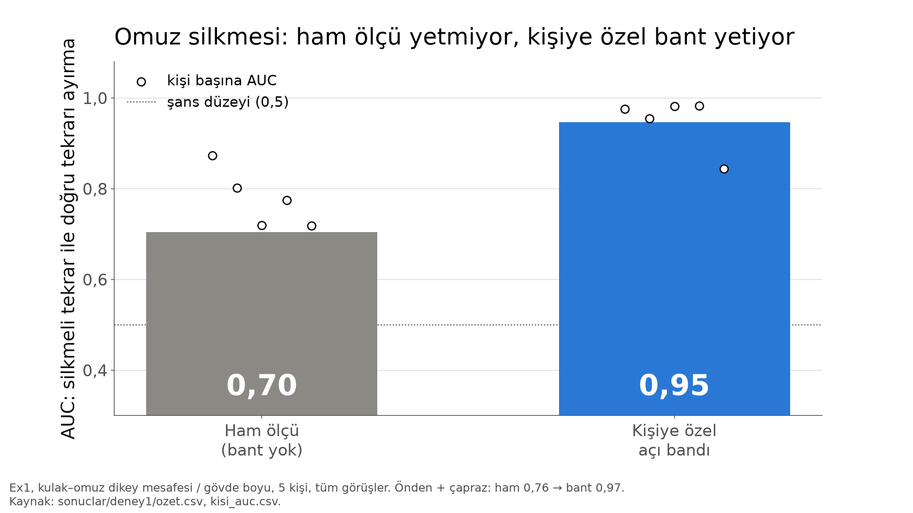
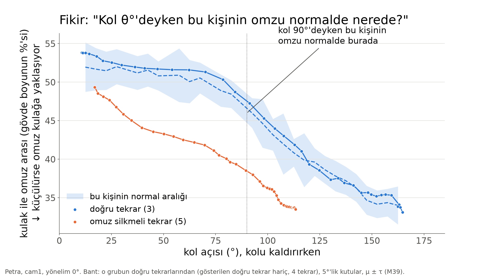
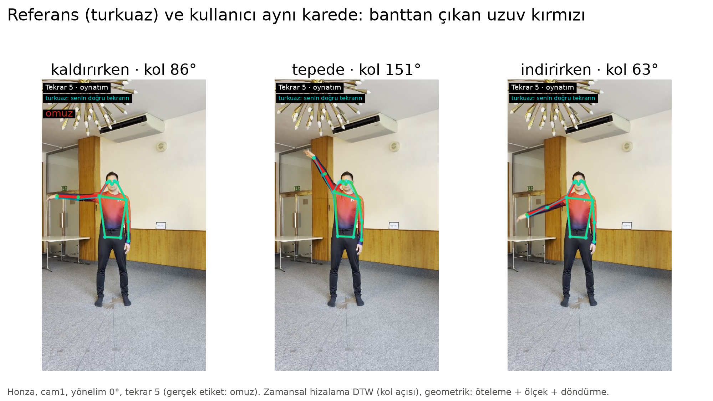

# Sonuçların özeti (dondurma, Adım 9)

> Bütün sayılar köşeli parantez içindeki kaynak dosyadan kopyalandı (`sonuclar/` altına göre yol). Tablolarda 3 ya da 2 basamağa yuvarlandı; tam değerler kaynak dosyada. Yöntem Karar 18 ile donduruldu; aşağıdaki hiçbir sayıya bakılarak yöntem değiştirilmedi.
>
> **Yeniden üretim:** _dondurmada eklenecek (commit kimliği ve "yeniden üretim: N/N aynı"; Karar 55)._

## Ne yaptık, ne bulduk (5 cümle)
1. Tek bir RGB kamerayla kolu yana kaldırma egzersizinde omuz silkmesini ve dört başka hatayı bulan, kişiye **Türkçe ve ölçülü** bir düzeltme cümlesi veren bir sistem kurduk; açık REHAB26-ViewAngles veri setinin 5 kişisinde kişi bazlı birini-dışarıda-bırak ile ölçtük.
2. Ham MediaPipe ölçüsü omuz silkmesini zayıf ayırıyor (AUC 0,70), kişinin kendi doğru tekrarlarından kurulan **açı bandı** ile 0,95'e çıkıyor [`deney1b/ozet.csv`]; başkalarının tekrarlarından kurulan genel bant ise 0,62–0,67'de kalıyor, yani kalibrasyon kişiye özel olmalı.
3. Hata türü, hatalı tekrarların yaklaşık yarısında ilk sırada (önden + çapraz 56,6/100), üçte ikisinde ilk iki içinde (67,4/100) doğru söyleniyor; doğru tekrarların 7,5/100'ünde gereksiz uyarı çıkıyor [`deney3/ozet.csv`].
4. Cümleyi bir LLM'e yazdırmak kurala üstünlük getirmiyor; hatayı LLM'e buldurmak ise doğru hatayı söyleme oranını 16 puan düşürüyor [`deney4/ozet.csv`, `deney4/bootstrap.csv`].
5. Kendi evde çektiğimiz videoda (tek kişi, 21 tekrar) 11 hatalı tekrarın 11'inde doğru hata cümlede geçti, 9'unda ilk söylenen oydu; 5 normal doğru tekrarın hiçbirinde uyarı çıkmadı [`kendi_kayit/kisi1/ozet.csv`].

## En önemli üç şekil
| | |
| --- | --- |
|  | **`sunum/1_problem.png`** — Ham ölçü 0,70 → kişiye özel açı bandı 0,95 (silkme/doğru AUC, tüm görüşler; noktalar kişiler). Önden + çapraz: 0,76 → 0,97. |
|  | **`sunum/2_fikir_aci_bandi.png`** — "Kol θ°'deyken bu kişinin omzu normalde nerede?" Petra, önden: doğru tekrar bandın içinde, silkmeli tekrar dışında. |
|  | **`sunum/5_bindirme.png`** — Referans iskelet (turkuaz) kullanıcının videosuna zamanda (DTW) ve geometride hizalanıp bindirilir; banttan çıkan uzuv kırmızı (Problem 3). |

## Deney başına tek tablo

### Deney 1 v2 — yöntem düzeltmelerinin ablasyonu (YENI = kulak–omuz ölçütü)
[`deney1_v2/ozet.csv`, `deney1_v2/bootstrap.csv`]

| Koşul | silkme/doğru (tüm) | silkme/diğer (tüm) | silkme/doğru (ö+ç) | silkme/diğer (ö+ç) | kişi AUC |
| --- | --- | --- | --- | --- | --- |
| v1 (M39'a sadık) | 0,909 | 0,705 | 0,936 | 0,743 | 0,91 (0,80–0,98) |
| v1a (+ pay hariç) | 0,927 | 0,720 | 0,946 | 0,749 | 0,93 (0,82–0,99) |
| v1b (+ çoklu referans) | 0,940 | 0,721 | 0,955 | 0,752 | 0,94 (0,84–0,99) |
| **v2 (açı bandı)** | **0,947** | **0,829** | **0,968** | **0,862** | 0,95 (0,84–0,98) |

- Asıl kazanç silkmeyi **diğer hatalardan** ayırmada: v2 − v1b = +0,108 (%95 GA +0,053 – +0,190). Silkme/doğruda v2 − v1b = +0,006 (GA −0,012 – +0,029), iddia yok (Karar 12).

### Deney 1b — genel bant mı, kişiye özel bant mı? (v2, YENI)
[`deney1b/ozet.csv`, `deney1b/bootstrap.csv`]

| Bant | silkme/doğru (tüm) | silkme/doğru (ö+ç) | silkme/diğer (tüm) |
| --- | --- | --- | --- |
| Bant yok (ham) | 0,704 | 0,761 | 0,699 |
| Genel: diğer 4 kişinin bütün doğru tekrarları | 0,666 | 0,683 | 0,649 |
| Genel: başka tek bir kişinin kalibrasyonu | 0,618 | 0,634 | 0,603 |
| **Kişiye özel** | **0,947** | **0,968** | **0,829** |

- Genel bant − kişiye özel: −0,280 (GA −0,406 – −0,141) ve −0,329 (GA −0,484 – −0,184), tüm görüşler. Bütün ölçüt/bant/görüş kapsamlarında GA sıfırı içermiyor (36/36; Karar 11).

### Deney 1c — zamansal yumuşatma (v2, YENI, silkme/doğru)
[`deney1c/ozet.csv`, `deney1c/bootstrap.csv`, `deney1c/titreme.csv`]

| Yumuşatma | tüm görüşler | önden + çapraz |
| --- | --- | --- |
| Yok | 0,947 | 0,968 |
| One Euro | 0,943 | 0,966 |
| Savitzky–Golay | 0,947 | 0,967 |

- Titreme (sağ omuz) ham değerin 0,13–0,62'sine iniyor (yani %38–87 azalıyor), ama AUC değişmiyor. **Olumsuz sonuç:** yumuşatma kullanılmaz (Karar 10).

### Deney 2 — hata türünü bulma (ana sistem: v2 yönlü)
[`deney2/ozet.csv`, `deney2/ilk_iki.csv`, `deney2/temel_cizgi.csv`]

| Görüş | makro-F1 (katı) | hatalılarda tür doğru /100 | birincil ilk iki z içinde /100 | hatalılarda "doğru" dedi /100 | doğruya "doğru" deme |
| --- | --- | --- | --- | --- | --- |
| **önden + çapraz** | **0,631** | **56,6** | 77,3 | 15,5 | 0,925 |
| tüm görüşler | 0,581 | 49,3 | 73,1 | 23,5 | 0,927 |
| profil (70–90°) | 0,296 | 16,4 | 54,6 | 59,2 | 0,935 |

- Temel çizgi (tek toplam hata, yalnızca doğru/yanlış), önden + çapraz: ikili doğruluk 0,889; 6 sınıflı kural 0,885. Kural tür de söylüyor, doğru/yanlış ayrımında temel çizgiyle aynı düzeyde.

### Ex7 (omuz ekstansiyonu) — ayarsız doğrulama (YENI, silkme/doğru)
[`ex7/d1_auc.csv`, `ex7/d1_farklar.csv`, `ex7/d2_ozet.csv`]

| | v1b (zaman bandı) | v2 (açı bandı) |
| --- | --- | --- |
| çapraz + profil (Ex7'nin uygulama senaryosu) | 0,939 | 0,888 |
| tüm görüşler | 0,945 | 0,895 |

- Silkme tespiti başka bir harekete taşınıyor (0,89–0,94). Ama Ex7'de açı bandı v1b'den kötü: −0,051 (GA −0,089 – −0,024). Hata türü Ex7'de zayıf: v2 yönlü makro-F1 0,399 (çapraz + profil). Hiçbir sabit değiştirilmedi (Karar 19).

### Deney 3 — kural tabanlı Türkçe cümle (hasta cümlesi)
[`deney3/ozet.csv`, `deney3/bootstrap.csv`]

| Görüş | katı /100 | ilk iki /100 | hatalılarda olumlu cümle /100 | doğrularda gereksiz uyarı /100 | çıkarıcı uyumu /100 |
| --- | --- | --- | --- | --- | --- |
| **önden + çapraz** | **56,6** (GA 42,3–70,4) | **67,4** (GA 50,6–80,1) | 15,5 | **7,5** (GA 3,9–10,4) | 100 |
| tüm görüşler | 49,3 | 58,8 | 23,5 | 7,3 | 100 |

- Hasta cümlesi ile uzman ayrıntısı aynı metrikleri veriyor (Karar 28). Cümleye çevirme kayıpsız: Deney 2'nin kararıyla birebir.

### 6b — görüntüden omuz silueti (SILUET) ile YENI (aynı 1363 tekrar, önden + çapraz)
[`siluet/ozet.csv`, `siluet/bootstrap.csv`]

| Ölçüt | silkme/doğru | silkme/diğer | önden | çapraz | kişi AUC |
| --- | --- | --- | --- | --- | --- |
| SILUET | 0,716 | 0,625 | 0,938 | 0,549 | 0,72 (0,53–0,79) |
| YENI_mp122 (aynı MediaPipe 1.2.2 çalıştırması) | 0,969 | 0,862 | 0,987 | 0,957 | 0,97 (0,91–1,00) |
| YENI (Deney 1 v2, kayıtlı, 0.10.20) | 0,968 | 0,862 | 0,979 | 0,960 | – |

- SILUET − YENI_mp122: −0,253 (GA −0,356 – −0,166). **Olumsuz sonuç** (Karar 52): "Görüntüden omuz silueti denendi; bu tanımla anahtar noktalardan daha iyi değil: önden çekimde silkmeyi ayırıyor (AUC 0,94), çapraz çekimde arama bölgesi başın üstüne düşüyor (0,55)." Başa takılma tanısı sonradan yapılmış betimsel bir analizdir (ADIM_06b bölüm 5).
- Yan bulgu: YENI_mp122 0,969, kayıtlı YENI 0,968; MediaPipe sürüm farkı bu ölçütü pratikte etkilemiyor.

### Deney 4 — LLM ile kural tabanlı karşılaştırması (150 tekrar, gemini-3.5-flash-lite)
Birincil tablo [`deney4/ozet.csv`, `deney4/bootstrap.csv`]; insan düzeltmeli duyarlılık analizi [`deney4/kaldirma_ozet.csv`, `deney4/kaldirma_bootstrap.csv`] (Karar 42).

| Metrik | A: kural | B: LLM + sapma kodu | C: LLM + ham özet |
| --- | --- | --- | --- |
| katı /100 | 61 | 61 | 45 |
| ilk iki /100 | 73 | 74 | 69 |
| ilk iki /100, insan düzeltmeli | 73 | 73 | 69 |
| doğrularda gereksiz uyarı /100 | 8 | 18 | 16 |
| doğrularda gereksiz uyarı /100, insan düzeltmeli | 8 | 8 | 16 |
| eklenen hata /100 | 0 | 6,67 | 32,67 |
| sayı uydurdu /100 | 0 | 0,67 | 0 |
| sayı içeren /100 | 94 | 87,33 | 11,33 |
| üslup ihlali: %, yüzde, gövde boyu /100 | 0 | 11,33 | 0,67 |

- C − A katı: −16 (GA −26 – −5); C − A gereksiz uyarı: +8 (GA 2 – 14); insan düzeltmeli B − A gereksiz uyarı: 0 (GA 0 – 0). B'nin birincil tablodaki fazladan uyarısı çıkarıcının "yukarı kaldır" kalıbını yanlış okumasından [`deney4/kaldirma_uyum.csv`: B'de 11 + 2 uyumsuzluk].

### Adım 7 — kendi kaydımız (kişi 1, 6 kalibrasyon + 21 test tekrarı, ev ortamı)
[`kendi_kayit/kisi1/ozet.csv`, `kendi_kayit/kisi1/karisiklik.csv`]

| Metrik | Grup | Kaçta kaç |
| --- | --- | --- |
| tekrar ayrıldı | bütün tekrarlar | 21/21 |
| katı | hatalı (hepsi) | 9/11 |
| ilk iki | hatalı (hepsi) | 11/11 |
| olumlu cümle | hatalı (hepsi) | 0/11 |
| katı / ilk iki | omuz silkmesi | 3/3 / 3/3 |
| gereksiz uyarı | doğru (normal) | 0/5 |
| gereksiz uyarı | doğru, başka yere bakış | 3/3 |
| gereksiz uyarı | doğru, hızlı | 2/2 |
| hız notu | doğru, hızlı | 2/2 |

- Tek kişi; güven aralığı verilmez; veri seti sonuçlarıyla yalnızca yan yana konur (Karar 51).

### Tekrar ayırma (uygulamanın otomatik tekrar bulucusu, `Segmentation.csv`'ye karşı)
[`tekrar_ayirma/ozet.csv`]

| Görüş | bulunan /100 | IoU medyan | fazladan |
| --- | --- | --- | --- |
| önden + çapraz | 95,01 | 0,85 | 34 |
| tüm görüşler | 87,35 | 0,85 | 63 |
| profil (70–90°) | 53,11 | 0,72 | 29 |

## İddia kapsamı (Karar 20, 23, 41, 47, 51 birlikte)
| İddia | Kanıt | Güç |
| --- | --- | --- |
| Kişiye özel bant, sabit kuraldan (ham ölçü) iyi silkme bulur | Ex1 0,70 → 0,95 [`deney1b/ozet.csv`]; Ex7'de ayarsız 0,89–0,94 [`ex7/d1_auc.csv`] | **Güçlü** |
| Kalibrasyon kişiye özel olmalı | genel bant 0,19–0,33 AUC geride, 36/36 GA sıfırı içermiyor [`deney1b/bootstrap.csv`] | **Güçlü** |
| Açı bandı silkmeyi diğer hatalardan daha iyi ayırır | v2 − v1b +0,108 (GA +0,053 – +0,190) [`deney1_v2/bootstrap.csv`]; Ex7'de yok | Orta; yalnızca geniş açılı hareketler |
| Hata türü bulunabilir | Ex1 makro-F1 0,631 [`deney2/ozet.csv`]; Ex7 0,399 [`ex7/d2_ozet.csv`] | Orta (Ex1), zayıf (Ex7) |
| Zamansal yumuşatma gerekmez | AUC değişmedi [`deney1c/bootstrap.csv`] | Olumsuz sonuç |
| Profil görüş uygun değil | Deney 2 profil makro-F1 0,296; tekrar ayırma 53,11/100 | Sınırlılık |
| Cümleler hatayı açıkça adlandırır | çıkarıcı uyumu 100/100 [`deney3/ozet.csv`]; çıkarıcı aynı şablonlarla geliştirildi | Zayıf kanıt (bağımsız sınama Deney 4'te) |
| İki hata söylemek gerçek hatayı söyleme oranını artırır | ö+ç 56,6 → 67,4; bedeli doğrularda iki uyarı 1,6/100 [`deney2/ilk_iki.csv`] | Orta |
| Doğru tekrarlarda gereksiz uyarı az | 7,5/100, GA 3,9–10,4 [`deney3/bootstrap.csv`] | Orta |
| Fiziksel ölçü omuz ve başta makul | dirsek ve öne kaçmada tek kare sorunu; sağlam ölçü yalnızca anlatımda (Karar 21) | Sınırlı |
| LLM yalnızca cümle yazarsa (B) kararı korur, üstünlük getirmez | katı 61/61, insan düzeltmeli ilk iki 73/73, gereksiz uyarı 8/8, B − A GA 0–0 [`deney4/kaldirma_bootstrap.csv`] | Güçlü (bu örneklem ve model için) |
| LLM hatayı da bulursa (C) daha kötü | katı −16 (GA −26 – −5); gereksiz uyarı +8 (GA 2–14); eklenen hata +32,67 (GA 27,33–39,33) | Orta-güçlü; tek model, tek istem |
| C fiziksel büyüklüğü çoğunlukla söylemez | sayı içeren A 94, B 87,33, C 11,33 /100 [`deney4/ozet.csv`] | Betimsel |
| LLM sayı uydurur (beklenti) | B 0,67/100 (1/150), C 0 | **Tutmadı**; olduğu gibi raporlanır |
| Sistem hiç görmediği bir kişide, ev koşullarında çalışıyor | 21/21 ayrıldı; katı 9/11, ilk iki 11/11; silkme 3/3; normal doğruda gereksiz uyarı 0/5 [`kendi_kayit/kisi1/ozet.csv`] | **İşaret** (tek kişi, kişi geliştirici) |
| Dirsek ile öne kaçma tek kamerada karışır | kendi kayıtta 2 kaçırmanın ikisi bu çift; 18 ve 21'de iki hata birden | Veri setiyle tutarlı |
| Başka yere bakmak gereksiz uyarı üretebilir | bakış 3/3, normal 0/5; ama 13'te baş gerçekten eğilmiş | Zayıf işaret |
| Hızlı doğru tekrar gereksiz uyarı üretebilir | hızlı 2/2 küçük omuz uyarısı; hız notu 2/2 | İşaret; sebebi doğrulanmadı |
| Başı sağa eğmek omuz ölçütünü de tetikler | kendi kayıt 19 (sağa) omuz ikinci hata, 11 (sola) değil; veri setinde baş etiketli 138 tekrarın 46'sında omuz da söylendi | Tek örnek + veri seti tutarlı |

## Sınırlılıklar
- **Veri:** 5 sağlıklı kişi; hatalar taklit, gerçek hasta yok. Tek etiketleyici (veri seti); yalnızca birincil hata güvenilir etiketli.
- **Profil görüş** (70–90°): yana kaldırma kameraya doğru/uzağa bir harekete dönüşüyor, 2B kol açısı bozuluyor. Ana sonuçlar |görüş| ≤ 60° için.
- **Dar bant:** M39'un τ = t·s/√n'si ortalamanın güven aralığıdır, yeni tekrarın tahmin aralığı değil (n = 6'da ~2,6 kat dar); kişiye özel bant dar ve küçük sapmalar uyarıya dönüşebiliyor (Karar 29).
- **Karışmalar:** öne kaçma ile dirsek bükme (kol boyu ikisinde de kısalıyor) ve baş eğme ile omuz silkmesi (kulak–omuz mesafesi ikisinde de küçülüyor).
- **Ölçü:** cümledeki ölçü birincil sonuçta tek kareden; çapraz görüşte 2B dirsek açısı bazı karelerde çöküyor. Sağlam ölçü (Karar 21) yalnızca anlatım katmanında ve sonradan tanımlandı.
- **2B açı:** tek kameradan ölçek ve derinlik yok; derece değerleri yaklaşık (M20 ±7°).
- **MediaPipe sürümü:** veri seti 0.10.20, uygulama 1.2.2. Kol açısı farkı medyan 0,92°, %95 3,09° [`uygulama_saglik/ex1_Honza_cam1_o0_poz_farki.csv`]; YENI'de AUC farkı 0,001 [`siluet/ozet.csv`].
- **Adım 7:** tek kişi, tek oturum, değerlendiren aynı zamanda geliştirici, hatalar bilerek taklit; kaçta kaç olarak raporlandı, GA yok.
- **Bakış ve hız duyarlılığı:** başka yere bakmak ve hızlı tekrar gereksiz uyarı üretebilir; kullanım talimatı: kalibrasyonda ve değerlendirmede aynı yere bak, doğal hızda yap.
- **LLM (Deney 4):** tek model (ücretsiz katmanın günlük sınırı nedeniyle gemini-3.5-flash-lite; düşünme ayarı varsayılan), tek istem, sıfır atış, 150 tekrar; çıkarıcı B'nin serbest anlatımında yanılabiliyor (insan düzeltmesi tek etiketleyiciyle).
- **Tanımsız hareket:** sistem tanımadığı bir hareketi en yakın hata türüne atar ("hareket tanınmadı" yok).

## Başarısız ve olumsuz denemeler
| Deneme | Neden denendi | Sonuç | Kaynak |
| --- | --- | --- | --- |
| Revize az kaldırma puanı (Karar 13) | birimler arası karşılaştırılabilirlik | makro-F1 0,631 → 0,568 (fark −0,064, GA −0,117 – −0,007); ilk sürüme dönüldü (Karar 17) | `deney2_revize/ilk_surum_karsilastirma.csv` |
| Zamansal yumuşatma (Deney 1c) | hocanın P2 önerisi, MediaPipe titremesi | titreme %38–87 azaldı, AUC değişmedi | `deney1c/ozet.csv`, `deney1c/titreme.csv` |
| Omuz silueti (6b) | hocanın P2 önerisi: pose + lokal görüntü özelliği | 0,716 / YENI 0,969; çaprazda 0,549 | `siluet/ozet.csv` |
| "LLM sayı uydurur" beklentisi (Deney 4) | M21 | tutmadı: B 1/150, C 0/150 | `deney4/ozet.csv` |
| Genel bant (Deney 1b) | kalibrasyonsuz kullanım | kişiye özelden 0,19–0,33 geride | `deney1b/bootstrap.csv` |

## Gelecek çalışma
Ayrıntı: [`docs/GELECEK_CALISMA.md`](../docs/GELECEK_CALISMA.md). Hepsi yeni veride, önceden kayıtla denenmeli.
1. Öne kaçma için kol açısı + kol boyu birlikte.
2. Kaldırma puanında sabit ölçek.
3. Ex7 için yönsüz bant ya da zaman bandı.
4. Dinlenme ayarlı genel bant (kalibrasyonsuz kullanım).
5. Kol boyundan öne kaçma açısı (derece).
6. Geri bildirimdeki ölçünün sağlam alınması (kısmen yapıldı, Karar 21).
7. Şiddet eşiklerini yalnızca yakalanan tekrarlardan almak.
8. Tahmin aralığı tabanlı bant ya da τ'ya alt sınır.
9. Öne kaçma ölçütünü dirsekten ayırmak.
10. Omuz ölçütünü baş eğmesinden ayırmak.
11. Başka bir veri setinde, görülmemiş kişilerde doğrulama (ör. REHAB24-6).
12. Görüş açısına dayanıklı siluet ROI'si ve SILUET + YENI birleşimi.
